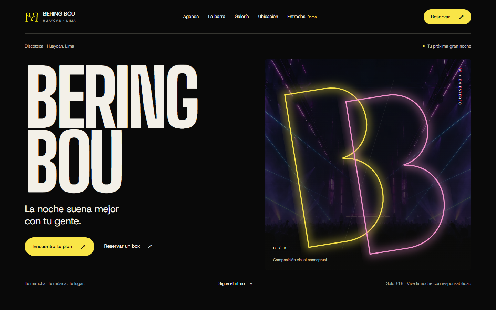
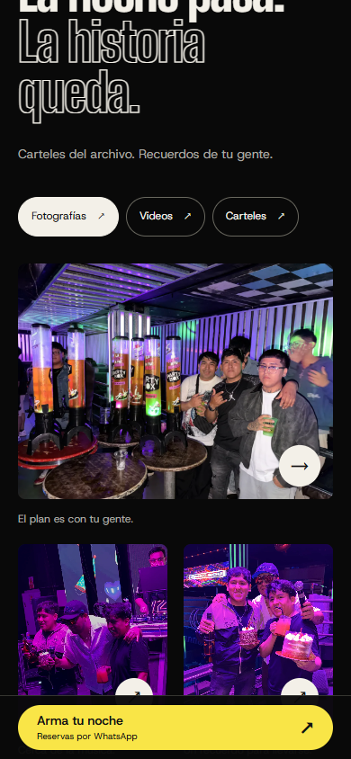

# Bering Bou · Bou en estéreo

Propuesta visual independiente para revisión. Se guarda en la rama **proposal/bou-en-estereo**, dentro de **proposals/bou-en-estereo/**. Esta subida no integra cambios en main ni cambia el directorio web de la página publicada. No ejecutar despliegues o fusionar la propuesta sin autorización.

## Abrir en local

Requiere Node 22.10 o superior y npm. Desde la raíz de este repositorio:

```sh
cd proposals/bou-en-estereo
npm ci
npm run build
npm run start -- --hostname 127.0.0.1 --port 4400
```

Abrir http://127.0.0.1:4400/. Para editar, usar npm run dev desde esta carpeta.

## Incluye

- Inicio: portada, agenda, reservas por WhatsApp, promociones y bebidas, galería, adelanto de entradas y ubicación.
- /conceptos: Bou en estéreo (elegido), Huaycán de noche y En primera fila, con comparación según /awwwards.
- /entradas: demo interactiva General/VIP. No vende, no cobra ni emite accesos válidos.
- Página de error 404 propia y bloqueo intencional de indexación para la propuesta.
- Tres fotografías reales facilitadas por el usuario y un clip de ambiente, optimizados para web. El video se descarga al solicitar reproducción.

El formulario prepara un mensaje visible para continuar voluntariamente en WhatsApp; no almacena datos ni confirma reservas. Esta propuesta no sustituye los servicios ni los datos del sistema publicado.

## Código y contenido

Next.js + TypeScript, GSAP y Lenis; scroll nativo en móvil, fuentes autoalojadas y tratamiento de movimiento reducido. Contenido comercial: src/data/site.ts. Galería: src/components/RealGallery.tsx. Estilos: src/app/globals.css.

Las fuentes y flyers oficiales se consultaron el 16/11/2026. ERROR figura como TikToker invitado el 21/11/2026; horarios, ingreso y condiciones se consultan con el local. El archivo de Halloween del 31/10/2026 no ofrece sus precios o promociones como vigentes. WhatsApp: +51 930 776 652, enlazado por la web oficial consultada.

## Verificación

Compilación de producción, revisión estática, pruebas de galería, video, menú, formularios, teclado y ausencia de desbordamiento a 390/768/1024/1440/1920 px. La revisión independiente con /jury anterior a las fotos del propietario obtuvo 7.54/10; no es una puntuación nueva de esta actualización ni está afiliada con Awwwards. Su informe histórico se conserva en docs/design-review-before-owner-media.md. Las capturas y herramientas externas de evaluación no se incluyen en este paquete de código.

Antes de publicar: confirmar carta, promociones, horarios y condiciones vigentes, revisar permisos de uso de imagen para publicación y conectar el sistema de entradas solo cuando esté definido.

## Publicación automática

La publicación existente conserva su configuración. La propuesta no modifica web/, el script de compilación raíz ni los workflows. El commit se sube a una rama separada con prefijo de omisión de CI. No se ha creado ningún despliegue o CNAME para esta propuesta.

## Vistas de la propuesta




